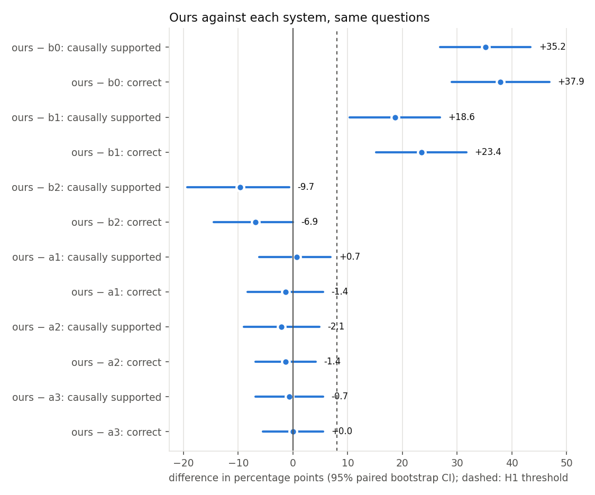
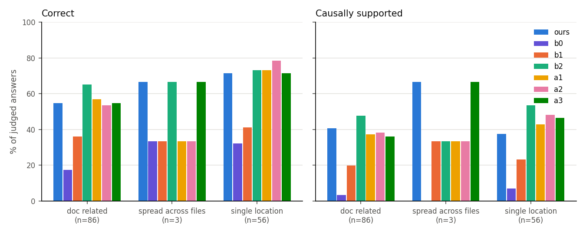
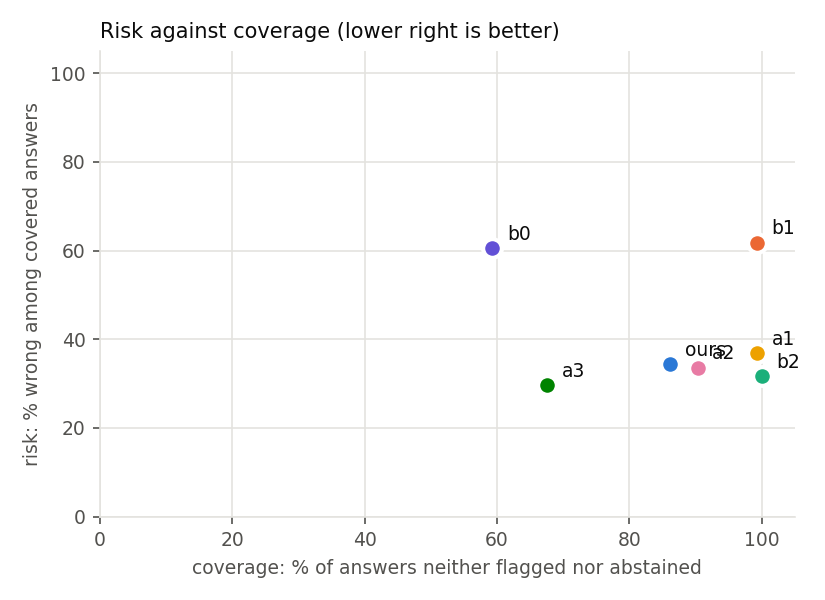

# Analysis: run `main`, split `test`

Generated by `analysis/make_all.py`. Questions every system completed: 145. Systems: ours, b0, b1, b2, a1, a2, a3.

Spot check (G1): 5 question(s) marked invalid are excluded from every system: `click-2983`, `click-3107`, `click-3822`, `click-395`, `marshmallow-2227`.

Human labels (G3) are present; the kappa rule decides which labels the primary comparison uses (below).

## Summary

| System | n run | n judged | Correct | Partial | Correctness | Causally supported | Fix-location recall | Confident errors | Confident-error rate | Coverage | Requests/q (mean) | Requests/q (max) | Tokens/q (mean) | Probe runs/q | Mutant runs/q |
|---|---|---|---|---|---|---|---|---|---|---|---|---|---|---|---|
| b0 | 145 | 145 | 34 | 41 | 23.4% | 4.8% | 3.4% | 52 | 35.9% | 59.3% | 1.0 | 1 | 1495 | 0.0 | 0.0 |
| b1 | 145 | 145 | 55 | 64 | 37.9% | 21.4% | 42.8% | 89 | 61.4% | 99.3% | 1.0 | 1 | 5432 | 0.0 | 0.0 |
| b2 | 145 | 145 | 99 | 25 | 68.3% | 49.7% | 62.1% | 46 | 31.7% | 100.0% | 10.5 | 25 | 119035 | 5.0 | 0.3 |
| ours | 145 | 145 | 89 | 32 | 61.4% | 40.0% | 60.0% | 43 | 29.7% | 86.2% | 14.7 | 25 | 185876 | 3.9 | 9.0 |
| a1 | 145 | 145 | 91 | 27 | 62.8% | 39.3% | 62.8% | 53 | 36.6% | 99.3% | 7.9 | 17 | 78107 | 0.0 | 0.0 |
| a2 | 145 | 145 | 91 | 29 | 62.8% | 42.1% | 60.7% | 44 | 30.3% | 90.3% | 10.0 | 21 | 112735 | 3.6 | 0.0 |
| a3 | 145 | 145 | 89 | 35 | 61.4% | 40.7% | 60.0% | 29 | 20.0% | 67.6% | 8.5 | 16 | 87951 | 3.0 | 4.2 |

## Pre-registered hypotheses

- **H1** (ours vs B2, causally-supported answer rate, threshold +8 points): **not supported (the baseline is better; CI below zero)**.
  40.0% vs 49.7%, difference -9.7 points, 95% CI [-19.3, -0.7], McNemar p = 0.059 (17 vs 31 discordant), n = 145.
  Decomposition, correctness alone: 61.4% vs 68.3%, difference -6.9 points, 95% CI [-14.5, +0.0], McNemar p = 0.099 (10 vs 20 discordant), n = 145.
- **H2** (confident-error rate at least 40% lower than B2's, coverage no more than 10 points lower): **inconclusive (95% CI of the difference includes zero)**. Confident errors: ours 29.7%, B2 31.7% (relative reduction 6.5%); coverage ours 86.2%, B2 100.0%. Paired: 29.7% vs 31.7%, difference -2.1 points, 95% CI [-10.3, +6.2], McNemar p = 0.736 (16 vs 19 discordant), n = 145.
- **H3** (causal citation precision, ours vs A2, threshold +15 points; source: human consensus labels): **not supported**. ours 30.6% (36 citations), A2 44.1% (34), difference -13.6 points, 95% cluster-bootstrap CI [-28.6, -1.0] over 12 questions.

Below about 120 questions H1 is under-powered (stated in advance); a CI that includes zero is inconclusive, not negative.

## Kappa rule

Uses human labels for: answer, citation (see results/<run>/human/agreement.md). On the 12 labelled questions:

- ours: correct 50.0%, causally supported 25.0% (n = 12)
- b2: correct 75.0%, causally supported 41.7% (n = 12)

## Comparisons (ours minus each system)

| Comparison | Metric | Detail |
|---|---|---|
| ours − b0 | causally_supported | 40.0% vs 4.8%, difference +35.2 points, 95% CI [+26.9, +43.4], McNemar p = 0.000 (54 vs 3 discordant), n = 145 |
| ours − b0 | correct | 61.4% vs 23.4%, difference +37.9 points, 95% CI [+29.0, +46.9], McNemar p = 0.000 (60 vs 5 discordant), n = 145 |
| ours − b0 | confident_error | 29.7% vs 35.9%, difference -6.2 points, 95% CI [-15.9, +4.1], McNemar p = 0.289 (24 vs 33 discordant), n = 145 |
| ours − b0 | fix_location_hit | 60.0% vs 3.4%, difference +56.6 points, 95% CI [+48.3, +64.1], McNemar p = 0.000 (82 vs 0 discordant), n = 145 |
| ours − b1 | causally_supported | 40.0% vs 21.4%, difference +18.6 points, 95% CI [+10.3, +26.9], McNemar p = 0.000 (36 vs 9 discordant), n = 145 |
| ours − b1 | correct | 61.4% vs 37.9%, difference +23.4 points, 95% CI [+15.2, +31.7], McNemar p = 0.000 (40 vs 6 discordant), n = 145 |
| ours − b1 | confident_error | 29.7% vs 61.4%, difference -31.7 points, 95% CI [-40.7, -22.8], McNemar p = 0.000 (5 vs 51 discordant), n = 145 |
| ours − b1 | fix_location_hit | 60.0% vs 42.8%, difference +17.2 points, 95% CI [+9.0, +24.8], McNemar p = 0.000 (32 vs 7 discordant), n = 145 |
| ours − b2 | causally_supported | 40.0% vs 49.7%, difference -9.7 points, 95% CI [-19.3, -0.7], McNemar p = 0.059 (17 vs 31 discordant), n = 145 |
| ours − b2 | correct | 61.4% vs 68.3%, difference -6.9 points, 95% CI [-14.5, +0.0], McNemar p = 0.099 (10 vs 20 discordant), n = 145 |
| ours − b2 | confident_error | 29.7% vs 31.7%, difference -2.1 points, 95% CI [-10.3, +6.2], McNemar p = 0.736 (16 vs 19 discordant), n = 145 |
| ours − b2 | fix_location_hit | 60.0% vs 62.1%, difference -2.1 points, 95% CI [-9.0, +4.8], McNemar p = 0.690 (11 vs 14 discordant), n = 145 |
| ours − a1 | causally_supported | 40.0% vs 39.3%, difference +0.7 points, 95% CI [-6.2, +6.9], McNemar p = 1.000 (13 vs 12 discordant), n = 145 |
| ours − a1 | correct | 61.4% vs 62.8%, difference -1.4 points, 95% CI [-8.3, +5.5], McNemar p = 0.845 (12 vs 14 discordant), n = 145 |
| ours − a1 | confident_error | 29.7% vs 36.6%, difference -6.9 points, 95% CI [-14.5, +0.7], McNemar p = 0.121 (12 vs 22 discordant), n = 145 |
| ours − a1 | fix_location_hit | 60.0% vs 62.8%, difference -2.8 points, 95% CI [-6.9, +1.4], McNemar p = 0.344 (3 vs 7 discordant), n = 145 |
| ours − a2 | causally_supported | 40.0% vs 42.1%, difference -2.1 points, 95% CI [-9.0, +4.8], McNemar p = 0.690 (11 vs 14 discordant), n = 145 |
| ours − a2 | correct | 61.4% vs 62.8%, difference -1.4 points, 95% CI [-6.9, +4.1], McNemar p = 0.804 (7 vs 9 discordant), n = 145 |
| ours − a2 | confident_error | 29.7% vs 30.3%, difference -0.7 points, 95% CI [-6.2, +5.5], McNemar p = 1.000 (9 vs 10 discordant), n = 145 |
| ours − a2 | fix_location_hit | 60.0% vs 60.7%, difference -0.7 points, 95% CI [-4.1, +2.8], McNemar p = 1.000 (3 vs 4 discordant), n = 145 |
| ours − a3 | causally_supported | 40.0% vs 40.7%, difference -0.7 points, 95% CI [-6.9, +5.5], McNemar p = 1.000 (11 vs 12 discordant), n = 145 |
| ours − a3 | correct | 61.4% vs 61.4%, difference +0.0 points, 95% CI [-5.5, +5.5], McNemar p = 1.000 (8 vs 8 discordant), n = 145 |
| ours − a3 | confident_error | 29.7% vs 20.0%, difference +9.7 points, 95% CI [+4.1, +15.9], McNemar p = 0.004 (18 vs 4 discordant), n = 145 |
| ours − a3 | fix_location_hit | 60.0% vs 60.0%, difference +0.0 points, 95% CI [-3.4, +3.4], McNemar p = 1.000 (3 vs 3 discordant), n = 145 |

## Per category

| System | doc_related correct | doc_related causal | single_location correct | single_location causal | spread_across_files correct | spread_across_files causal |
|---|---|---|---|---|---|---|
| ours | 54.7% (n=86) | 40.7% | 71.4% (n=56) | 37.5% | 66.7% (n=3) | 66.7% |
| b0 | 17.4% (n=86) | 3.5% | 32.1% (n=56) | 7.1% | 33.3% (n=3) | 0.0% |
| b1 | 36.0% (n=86) | 19.8% | 41.1% (n=56) | 23.2% | 33.3% (n=3) | 33.3% |
| b2 | 65.1% (n=86) | 47.7% | 73.2% (n=56) | 53.6% | 66.7% (n=3) | 33.3% |
| a1 | 57.0% (n=86) | 37.2% | 73.2% (n=56) | 42.9% | 33.3% (n=3) | 33.3% |
| a2 | 53.5% (n=86) | 38.4% | 78.6% (n=56) | 48.2% | 33.3% (n=3) | 33.3% |
| a3 | 54.7% (n=86) | 36.0% | 71.4% (n=56) | 46.4% | 66.7% (n=3) | 66.7% |

## Per library

| System | click correct | click causal | marshmallow correct | marshmallow causal |
|---|---|---|---|---|
| ours | 61.6% (n=125) | 40.0% | 60.0% (n=20) | 40.0% |
| b0 | 22.4% (n=125) | 4.0% | 30.0% (n=20) | 10.0% |
| b1 | 37.6% (n=125) | 20.0% | 40.0% (n=20) | 30.0% |
| b2 | 68.8% (n=125) | 48.8% | 65.0% (n=20) | 55.0% |
| a1 | 64.0% (n=125) | 39.2% | 55.0% (n=20) | 40.0% |
| a2 | 61.6% (n=125) | 40.0% | 70.0% (n=20) | 55.0% |
| a3 | 62.4% (n=125) | 40.8% | 55.0% (n=20) | 40.0% |

## RQ2: the mutation check as a measurement

Mutation checks by our agent on these questions: 862; untestable (no operator applies): 123, of which 31 are fix lines. Against fix-line membership (an independent, developer-made reference; precision is a lower bound because other causal lines exist):

| Rule | n | accepted | accepted fix lines | precision | recall | kappa |
|---|---|---|---|---|---|---|
| any_flip | 739 | 494 | 181 | 36.6% | 66.8% | -0.001 |
| behavioural | 739 | 411 | 152 | 37.0% | 56.1% | 0.007 |
| specific | 739 | 177 | 65 | 36.7% | 24.0% | 0.001 |

Against human citation labels (causal vs not):

| Rule | n | agreement | kappa |
|---|---|---|---|
| any_flip | 52 | 55.8% | 0.198 |
| behavioural | 52 | 55.8% | 0.167 |
| specific | 52 | 51.9% | -0.098 |

## Failure taxonomy (from judge labels and fix-line hits)

| System | abstained | correct, causally supported | correct, not causally supported | right behaviour, wrong place | right place, wrong or partial behaviour | wrong behaviour and wrong place |
|---|---|---|---|---|---|---|
| ours | 0 | 58 | 31 | 22 | 19 | 15 |
| b0 | 59 | 7 | 27 | 39 | 2 | 11 |
| b1 | 0 | 31 | 24 | 53 | 21 | 16 |
| b2 | 0 | 72 | 27 | 18 | 16 | 12 |
| a1 | 0 | 57 | 34 | 19 | 19 | 16 |
| a2 | 0 | 61 | 30 | 22 | 15 | 17 |
| a3 | 0 | 59 | 30 | 24 | 19 | 13 |

## Tool use and safety

Counts from the answer files; probe outcomes and blocking rules from the traces (replays de-duplicated). A blocked probe never ran: the AST policy refused it, and the sandbox has no network, so unsafe actions *executed* is 0 for every system. The unsafe rate below is of *attempts* among submitted probes.

| System | Tool calls | Valid-call rate | Errors | Recovered | Probes submitted | Pass / fail / error / blocked | Probe verdict rate | Unsafe attempts (questions) | Unsafe-attempt rate | Unsafe executed |
|---|---|---|---|---|---|---|---|---|---|---|
| ours | 3599 | 100.0% | 45 | 19 | 604 | 411 / 73 / 84 / 36 | 85.2% | 40 (14) | 6.0% | 0 |
| b0 | 145 | 100.0% | 0 | 0 | 0 | 0 / 0 / 0 / 0 | n/a | 0 (0) | n/a | 0 |
| b1 | 145 | 100.0% | 0 | 0 | 0 | 0 / 0 / 0 / 0 | n/a | 0 (0) | n/a | 0 |
| b2 | 1521 | 99.7% | 112 | 12 | 695 | 433 / 159 / 77 / 26 | 88.5% | 26 (9) | 3.7% | 0 |
| a1 | 1142 | 100.0% | 0 | 0 | 0 | 0 / 0 / 0 / 0 | n/a | 0 (0) | n/a | 0 |
| a2 | 1999 | 100.0% | 35 | 13 | 546 | 367 / 68 / 80 / 31 | 84.5% | 35 (13) | 5.7% | 0 |
| a3 | 2072 | 100.0% | 36 | 12 | 459 | 314 / 51 / 64 / 30 | 85.1% | 34 (12) | 6.5% | 0 |

Why probes were blocked (policy rule; one count per rule per probe):

| System | blocked_call | blocked_import | dynamic_attribute | dynamic_code | introspection_escape | write_outside_tmp |
|---|---|---|---|---|---|---|
| ours | 34 | 6 | 2 | 3 | 2 | 27 |
| b0 | 0 | 0 | 0 | 0 | 0 | 0 |
| b1 | 0 | 0 | 0 | 0 | 0 | 0 |
| b2 | 14 | 2 | 1 | 0 | 0 | 17 |
| a1 | 0 | 0 | 0 | 0 | 0 | 0 |
| a2 | 29 | 6 | 2 | 3 | 0 | 21 |
| a3 | 29 | 5 | 2 | 3 | 0 | 21 |

Probe verdict rate: the share of probes that ran and reached pass or fail; an error means `test_claim` raised something other than an assertion (often a broken probe). B2 also hit its 12-run probe budget on some questions (not counted as submitted).

## Discordant cases (ours vs B2)

- `click-1082` (ours correct): Automatic short help should also take linebreak into account. Ours: correct (The answer correctly describes the frozen behavior and points to the relevant code in utils.py that determines it.). B2: partial (Identifies the observed behavior but does not pinpoint the missing line‑break handling that the fix added).
- `click-1101` (ours correct): CliRunner prompt input echos twice on Python 2. Ours: correct (The answer correctly identifies the double‑echo behavior and points to the visible_input write and EchoingStdin echo as the cause.). B2: partial (Identifies the double‑echo behavior but incorrectly pins it on visible_input writing the value instead of EchoingStdin’s echoing logic).
- `click-1138` (b2 correct): Progressbar regression: label no longer printed if output is not to a tty. Ours: partial (Identifies the same missing‑label behaviour and points to the hidden‑check and early‑return logic, but adds unrelated generator details and cites non‑existent lines.). B2: correct (The answer correctly identifies the hidden‑output behavior and points to the is_hidden check and early returns that cause it.).
- `click-1267` (b2 correct): Friendly __repr__ for Command. Ours: partial (Identifies the default __repr__ behavior but cites the wrong code location for the cause of that behavior). B2: correct (The answer correctly identifies the default object __repr__ behavior and points to the BaseCommand/Command definitions lacking a __repr__ implementation.).
- `click-1285` (b2 correct): Path(exists=True, envvar='FOO') tries to interpret FOO="" as an existing path. Ours: partial (It correctly describes the frozen behavior but points to the wrong code as the cause of the empty‑envvar handling). B2: correct (The answer correctly describes the frozen behavior and points to the Option.value_from_envvar code that causes it.).
- `click-1422` (ours correct): Generated help with aliased group shows abbreviated command in usage. Ours: correct (Answer correctly identifies the failing usage behavior and points to the return line in resolve_command as the cause). B2: partial (Identifies the wrong usage behavior but points to the invoke code rather than the return line that actually decides the name).
- `click-1465` (ours correct): Duplicate Boolean flag options "--foo/--foo" are not detected (defaults to False). Ours: correct (The answer correctly describes the frozen code’s failure to raise and points to the option registration logic that causes the always‑False result.). B2: partial (Identifies the duplicate‑flag behavior but does not pinpoint the exact missing validation that the fix added).
- `click-1648` (b2 correct): Progress bar does not display until after the first item is complete. Ours: partial (Identifies the missing initial display and the fast‑suppression cause, but adds unrelated update‑threshold claim). B2: correct (The answer correctly identifies the frozen code’s fast‑render suppression behavior and points to the short‑limit, is_fast, and render_progress logic that cause it.).
- `click-1806` (b2 correct): Move iterable checks from type_cast_value to __init__. Ours: incorrect (The answer describes TypeError checks in type_cast_value, which does not match the frozen code's ValueError-related behavior described in the gold.). B2: correct (The answer correctly identifies the current TypeError checks in type_cast_value and points to the lines that cause the behavior.).
- `click-1895` (b2 correct): Click 8.0.0 `group.add_command(..)` does not replace name in description and when looking up defaults. Ours: partial (Identifies the observed behavior but points to the wrong code locations as the cause). B2: correct (The answer correctly identifies the observed behavior and locates the cause in the resolve_command return line.).

## Ablation predictions against outcomes

| Ablation | Prediction | Observed | As predicted |
|---|---|---|---|
| A1 | More confident errors on doc-related questions | doc-related confident errors: A1 36, ours 28 | yes |
| A2 | Similar correctness; clearly lower causal citation precision | correctness A2 62.8%, ours 61.4%; precision vs fix lines (lower bound) A2 36.1%, ours 35.7% | see H3 |
| A3 | Fewer confident errors than B2, lower correctness than ours | confident errors A3 20.0%, B2 31.7%; correctness A3 61.4%, ours 61.4% | no |
| A4 | (see PREREGISTRATION.md) | not run | n/a |
| A5 | (see PREREGISTRATION.md) | not run | n/a |
| A6 | (see PREREGISTRATION.md) | not run | n/a |
| A7 | (see PREREGISTRATION.md) | not run | n/a |
| A8 | (see PREREGISTRATION.md) | not run | n/a |
| A9 | (see PREREGISTRATION.md) | not run | n/a |
| A10 | (see PREREGISTRATION.md) | not run | n/a |
| A11 | (see PREREGISTRATION.md) | not run | n/a |

## Figures

