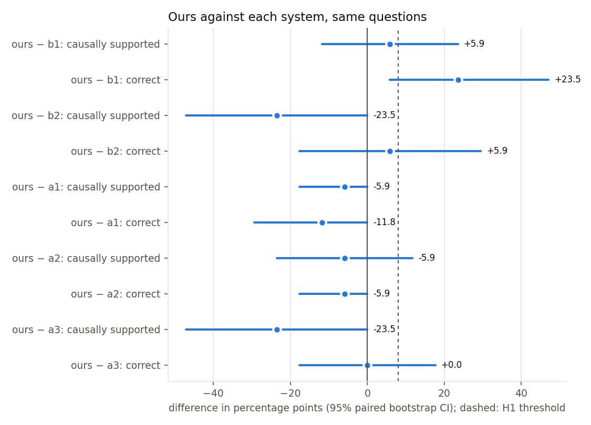
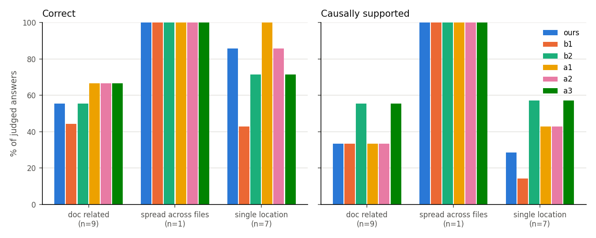
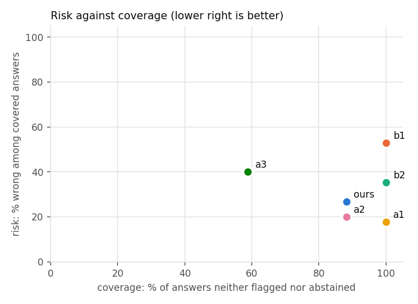

# Analysis: run `pilot_d51`, split `dev`

Generated by `analysis/make_all.py`. Questions every system completed: 17. Systems: ours, b1, b2, a1, a2, a3.

Spot check (G1): 3 question(s) marked invalid are excluded from every system: `click-1844`, `click-2396`, `marshmallow-2924`.

**No human labels yet (G3 pending): every judge-based number is provisional.**

## Summary

| System | n run | n judged | Correct | Partial | Correctness | Causally supported | Fix-location recall | Confident errors | Confident-error rate | Coverage | Requests/q (mean) | Requests/q (max) | Tokens/q (mean) | Probe runs/q | Mutant runs/q |
|---|---|---|---|---|---|---|---|---|---|---|---|---|---|---|---|
| b1 | 17 | 17 | 8 | 6 | 47.1% | 29.4% | 29.4% | 9 | 52.9% | 100.0% | 1.0 | 1 | 4987 | 0.0 | 0.0 |
| b2 | 17 | 17 | 11 | 3 | 64.7% | 58.8% | 64.7% | 6 | 35.3% | 100.0% | 9.9 | 25 | 127821 | 3.9 | 0.6 |
| ours | 17 | 17 | 12 | 2 | 70.6% | 35.3% | 52.9% | 4 | 23.5% | 88.2% | 14.7 | 23 | 197617 | 4.1 | 9.9 |
| a1 | 17 | 17 | 14 | 2 | 82.4% | 41.2% | 58.8% | 3 | 17.6% | 100.0% | 7.5 | 11 | 78411 | 0.0 | 0.0 |
| a2 | 17 | 17 | 13 | 3 | 76.5% | 41.2% | 58.8% | 3 | 17.6% | 88.2% | 10.1 | 21 | 123456 | 3.6 | 0.0 |
| a3 | 17 | 17 | 12 | 3 | 70.6% | 58.8% | 52.9% | 4 | 23.5% | 58.8% | 7.8 | 12 | 84725 | 2.8 | 4.1 |

## Pre-registered hypotheses

- **H1** (ours vs B2, causally-supported answer rate, threshold +8 points): **inconclusive (95% CI includes zero)**.
  35.3% vs 58.8%, difference -23.5 points, 95% CI [-47.1, +0.0], McNemar p = 0.219 (1 vs 5 discordant), n = 17.
  Decomposition, correctness alone: 70.6% vs 64.7%, difference +5.9 points, 95% CI [-17.6, +29.4], McNemar p = 1.000 (3 vs 2 discordant), n = 17.
- **H2** (confident-error rate at least 40% lower than B2's, coverage no more than 10 points lower): **inconclusive (95% CI of the difference includes zero)**. Confident errors: ours 23.5%, B2 35.3% (relative reduction 33.3%); coverage ours 88.2%, B2 100.0%. Paired: 23.5% vs 35.3%, difference -11.8 points, 95% CI [-41.2, +17.6], McNemar p = 0.688 (2 vs 4 discordant), n = 17.
- **H3** (causal citation precision, ours vs A2, threshold +15 points; source: judge labels (provisional until G3)): **inconclusive (95% CI includes zero)**. ours 52.7% (55 citations), A2 63.0% (46), difference -10.3 points, 95% cluster-bootstrap CI [-29.6, +5.1] over 17 questions.

Below about 120 questions H1 is under-powered (stated in advance); a CI that includes zero is inconclusive, not negative.

## Comparisons (ours minus each system)

| Comparison | Metric | Detail |
|---|---|---|
| ours − b1 | causally_supported | 35.3% vs 29.4%, difference +5.9 points, 95% CI [-11.8, +23.5], McNemar p = 1.000 (2 vs 1 discordant), n = 17 |
| ours − b1 | correct | 70.6% vs 47.1%, difference +23.5 points, 95% CI [+5.9, +47.1], McNemar p = 0.125 (4 vs 0 discordant), n = 17 |
| ours − b1 | confident_error | 23.5% vs 52.9%, difference -29.4 points, 95% CI [-52.9, -11.8], McNemar p = 0.062 (0 vs 5 discordant), n = 17 |
| ours − b1 | fix_location_hit | 52.9% vs 29.4%, difference +23.5 points, 95% CI [-5.9, +52.9], McNemar p = 0.289 (6 vs 2 discordant), n = 17 |
| ours − b2 | causally_supported | 35.3% vs 58.8%, difference -23.5 points, 95% CI [-47.1, +0.0], McNemar p = 0.219 (1 vs 5 discordant), n = 17 |
| ours − b2 | correct | 70.6% vs 64.7%, difference +5.9 points, 95% CI [-17.6, +29.4], McNemar p = 1.000 (3 vs 2 discordant), n = 17 |
| ours − b2 | confident_error | 23.5% vs 35.3%, difference -11.8 points, 95% CI [-41.2, +17.6], McNemar p = 0.688 (2 vs 4 discordant), n = 17 |
| ours − b2 | fix_location_hit | 52.9% vs 64.7%, difference -11.8 points, 95% CI [-35.3, +11.8], McNemar p = 0.625 (1 vs 3 discordant), n = 17 |
| ours − a1 | causally_supported | 35.3% vs 41.2%, difference -5.9 points, 95% CI [-17.6, +0.0], McNemar p = 1.000 (0 vs 1 discordant), n = 17 |
| ours − a1 | correct | 70.6% vs 82.4%, difference -11.8 points, 95% CI [-29.4, +0.0], McNemar p = 0.500 (0 vs 2 discordant), n = 17 |
| ours − a1 | confident_error | 23.5% vs 17.6%, difference +5.9 points, 95% CI [-11.8, +23.5], McNemar p = 1.000 (2 vs 1 discordant), n = 17 |
| ours − a1 | fix_location_hit | 52.9% vs 58.8%, difference -5.9 points, 95% CI [-17.6, +0.0], McNemar p = 1.000 (0 vs 1 discordant), n = 17 |
| ours − a2 | causally_supported | 35.3% vs 41.2%, difference -5.9 points, 95% CI [-23.5, +11.8], McNemar p = 1.000 (1 vs 2 discordant), n = 17 |
| ours − a2 | correct | 70.6% vs 76.5%, difference -5.9 points, 95% CI [-17.6, +0.0], McNemar p = 1.000 (0 vs 1 discordant), n = 17 |
| ours − a2 | confident_error | 23.5% vs 17.6%, difference +5.9 points, 95% CI [+0.0, +17.6], McNemar p = 1.000 (1 vs 0 discordant), n = 17 |
| ours − a2 | fix_location_hit | 52.9% vs 58.8%, difference -5.9 points, 95% CI [-17.6, +0.0], McNemar p = 1.000 (0 vs 1 discordant), n = 17 |
| ours − a3 | causally_supported | 35.3% vs 58.8%, difference -23.5 points, 95% CI [-47.1, +0.0], McNemar p = 0.219 (1 vs 5 discordant), n = 17 |
| ours − a3 | correct | 70.6% vs 70.6%, difference +0.0 points, 95% CI [-17.6, +17.6], McNemar p = 1.000 (1 vs 1 discordant), n = 17 |
| ours − a3 | confident_error | 23.5% vs 23.5%, difference +0.0 points, 95% CI [-17.6, +17.6], McNemar p = 1.000 (1 vs 1 discordant), n = 17 |
| ours − a3 | fix_location_hit | 52.9% vs 52.9%, difference +0.0 points, 95% CI [+0.0, +0.0], McNemar p = 1.000 (0 vs 0 discordant), n = 17 |

## Per category

| System | doc_related correct | doc_related causal | single_location correct | single_location causal | spread_across_files correct | spread_across_files causal |
|---|---|---|---|---|---|---|
| ours | 55.6% (n=9) | 33.3% | 85.7% (n=7) | 28.6% | 100.0% (n=1) | 100.0% |
| b1 | 44.4% (n=9) | 33.3% | 42.9% (n=7) | 14.3% | 100.0% (n=1) | 100.0% |
| b2 | 55.6% (n=9) | 55.6% | 71.4% (n=7) | 57.1% | 100.0% (n=1) | 100.0% |
| a1 | 66.7% (n=9) | 33.3% | 100.0% (n=7) | 42.9% | 100.0% (n=1) | 100.0% |
| a2 | 66.7% (n=9) | 33.3% | 85.7% (n=7) | 42.9% | 100.0% (n=1) | 100.0% |
| a3 | 66.7% (n=9) | 55.6% | 71.4% (n=7) | 57.1% | 100.0% (n=1) | 100.0% |

## Per library

| System | click correct | click causal | marshmallow correct | marshmallow causal |
|---|---|---|---|---|
| ours | 73.3% (n=15) | 40.0% | 50.0% (n=2) | 0.0% |
| b1 | 46.7% (n=15) | 33.3% | 50.0% (n=2) | 0.0% |
| b2 | 60.0% (n=15) | 53.3% | 100.0% (n=2) | 100.0% |
| a1 | 80.0% (n=15) | 40.0% | 100.0% (n=2) | 50.0% |
| a2 | 73.3% (n=15) | 40.0% | 100.0% (n=2) | 50.0% |
| a3 | 66.7% (n=15) | 53.3% | 100.0% (n=2) | 100.0% |

## RQ2: the mutation check as a measurement

Mutation checks by our agent on these questions: 95; untestable (no operator applies): 18, of which 0 are fix lines. Against fix-line membership (an independent, developer-made reference; precision is a lower bound because other causal lines exist):

| Rule | n | accepted | accepted fix lines | precision | recall | kappa |
|---|---|---|---|---|---|---|
| any_flip | 77 | 62 | 28 | 45.2% | 82.4% | 0.03 |
| behavioural | 77 | 57 | 27 | 47.4% | 79.4% | 0.09 |
| specific | 77 | 27 | 6 | 22.2% | 17.6% | -0.319 |

Against human labels: pending G3.

## Failure taxonomy (from judge labels and fix-line hits)

| System | correct, causally supported | correct, not causally supported | right behaviour, wrong place | right place, wrong or partial behaviour | wrong behaviour and wrong place |
|---|---|---|---|---|---|
| ours | 6 | 6 | 1 | 1 | 3 |
| b1 | 5 | 3 | 6 | 1 | 2 |
| b2 | 10 | 1 | 3 | 2 | 1 |
| a1 | 7 | 7 | 2 | 0 | 1 |
| a2 | 7 | 6 | 2 | 1 | 1 |
| a3 | 10 | 2 | 2 | 1 | 2 |

## Tool use and safety

Counts from the answer files; probe outcomes and blocking rules from the traces (replays de-duplicated). A blocked probe never ran: the AST policy refused it, and the sandbox has no network, so unsafe actions *executed* is 0 for every system. The unsafe rate below is of *attempts* among submitted probes.

| System | Tool calls | Valid-call rate | Errors | Recovered | Probes submitted | Pass / fail / error / blocked | Probe verdict rate | Unsafe attempts (questions) | Unsafe-attempt rate | Unsafe executed |
|---|---|---|---|---|---|---|---|---|---|---|
| ours | 417 | 100.0% | 1 | 1 | 70 | 50 / 12 / 7 / 1 | 89.9% | 1 (1) | 1.4% | 0 |
| b1 | 17 | 100.0% | 0 | 0 | 0 | 0 / 0 / 0 / 0 | n/a | 0 (0) | n/a | 0 |
| b2 | 167 | 99.4% | 7 | 0 | 56 | 44 / 6 / 5 / 1 | 90.9% | 1 (1) | 1.8% | 0 |
| a1 | 130 | 100.0% | 0 | 0 | 0 | 0 / 0 / 0 / 0 | n/a | 0 (0) | n/a | 0 |
| a2 | 237 | 100.0% | 1 | 1 | 63 | 44 / 11 / 7 / 1 | 88.7% | 1 (1) | 1.6% | 0 |
| a3 | 223 | 100.0% | 1 | 1 | 48 | 36 / 8 / 3 / 1 | 93.6% | 1 (1) | 2.1% | 0 |

Why probes were blocked (policy rule; one count per rule per probe):

| System | blocked_import |
|---|---|
| ours | 1 |
| b1 | 0 |
| b2 | 1 |
| a1 | 0 |
| a2 | 1 |
| a3 | 1 |

Probe verdict rate: the share of probes that ran and reached pass or fail; an error means `test_claim` raised something other than an assertion (often a broken probe). B2 also hit its 12-run probe budget on some questions (not counted as submitted).

## Discordant cases (ours vs B2)

- `click-1075` (b2 correct): Add newlines between options in help text. Ours: incorrect (The answer does not identify the missing blank line after multiline option help nor locate the cause in the correct code region that the fix changed.). B2: correct (The answer correctly identifies that the frozen HelpFormatter.write_dl lacks extra newlines after multi‑line help, matching the failing test, and points to the relevant code in formatting.py.).
- `click-1597` (ours correct): get help does not remove multiline marker. Ours: correct (The answer correctly identifies the failing behavior and points to make_default_short_help in utils as the source of the issue.). B2: incorrect (The answer claims the frozen code correctly removes the \b marker via formatting.py, which contradicts the gold description that the marker is not removed and the cause is in utils.make_default_short_help).
- `click-2522` (ours correct): `CliRunner`: restrict `mix_stderr` influence to `<output>`; keep `<stderr>` and `<stdout>` stable. Ours: correct (The answer correctly identifies the frozen code's behavior and points to the exact lines that cause it.). B2: incorrect (The answer misdescribes the frozen code's behavior for mix_stderr=False and does not identify the actual cause of the mixing bug).
- `click-2703` (ours correct): zsh completion still misbehaving in the presence of `:`. Ours: correct (The answer correctly identifies the colon‑splitting behavior and points to the format_completion implementation (line 376) as the cause, matching the gold description.). B2: partial (Identifies the observed colon-splitting behavior but points to the wrong code location as the cause).
- `marshmallow-1808` (b2 correct): 3.12 no longer supports fields named `parent`. Ours: partial (Identifies the same None root failure but attributes it to a naming conflict rather than the missing root attribute added by the fix). B2: correct (Answer correctly identifies the failing root being None and points to the root property implementation that causes it).

## Ablation predictions against outcomes

| Ablation | Prediction | Observed | As predicted |
|---|---|---|---|
| A1 | More confident errors on doc-related questions | doc-related confident errors: A1 3, ours 3 | no |
| A2 | Similar correctness; clearly lower causal citation precision | correctness A2 76.5%, ours 70.6%; precision vs fix lines (lower bound) A2 37.0%, ours 29.1% | see H3 |
| A3 | Fewer confident errors than B2, lower correctness than ours | confident errors A3 23.5%, B2 35.3%; correctness A3 70.6%, ours 70.6% | no |
| A4 | (see PREREGISTRATION.md) | not run | n/a |
| A5 | (see PREREGISTRATION.md) | not run | n/a |
| A6 | (see PREREGISTRATION.md) | not run | n/a |
| A7 | (see PREREGISTRATION.md) | not run | n/a |
| A8 | (see PREREGISTRATION.md) | not run | n/a |
| A9 | (see PREREGISTRATION.md) | not run | n/a |
| A10 | (see PREREGISTRATION.md) | not run | n/a |
| A11 | (see PREREGISTRATION.md) | not run | n/a |

## Figures

