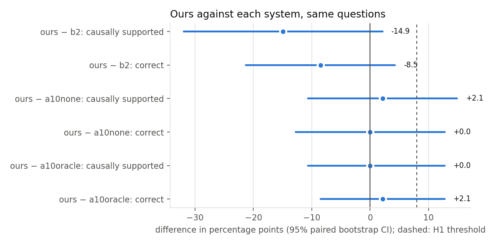
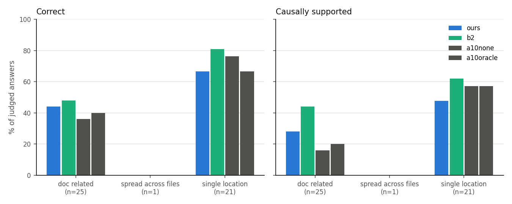
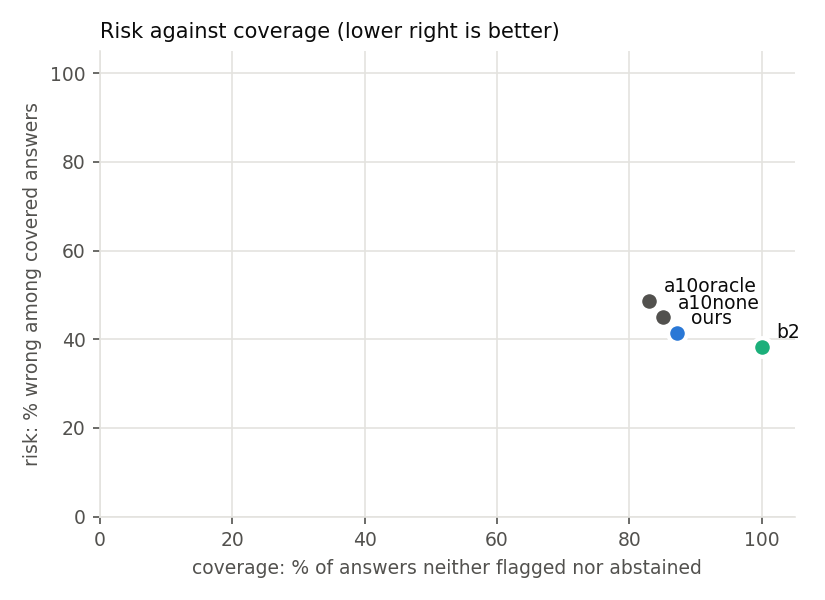

# Analysis: run `sub50`, split `test`

Generated by `analysis/make_all.py`. Questions every system completed: 47. Systems: ours, b2, a10none, a10oracle.

Spot check (G1): 5 question(s) marked invalid are excluded from every system: `click-2983`, `click-3107`, `click-3822`, `click-395`, `marshmallow-2227`.

**No human labels yet (G3 pending): every judge-based number is provisional.**

## Summary

| System | n run | n judged | Correct | Partial | Correctness | Causally supported | Fix-location recall | Confident errors | Confident-error rate | Coverage | Requests/q (mean) | Requests/q (max) | Tokens/q (mean) | Probe runs/q | Mutant runs/q |
|---|---|---|---|---|---|---|---|---|---|---|---|---|---|---|---|
| b2 | 47 | 47 | 29 | 9 | 61.7% | 51.1% | 61.7% | 18 | 38.3% | 100.0% | 9.9 | 25 | 109529 | 4.5 | 0.3 |
| ours | 47 | 47 | 25 | 13 | 53.2% | 36.2% | 59.6% | 17 | 36.2% | 87.2% | 14.9 | 24 | 187823 | 4.2 | 9.1 |
| a10none | 47 | 47 | 25 | 12 | 53.2% | 34.0% | 44.7% | 18 | 38.3% | 85.1% | 14.2 | 21 | 128328 | 3.9 | 9.0 |
| a10oracle | 47 | 47 | 24 | 13 | 51.1% | 36.2% | 55.3% | 19 | 40.4% | 83.0% | 13.6 | 23 | 272617 | 4.0 | 6.6 |

## Pre-registered hypotheses

- **H1** (ours vs B2, causally-supported answer rate, threshold +8 points): **inconclusive (95% CI includes zero)**.
  36.2% vs 51.1%, difference -14.9 points, 95% CI [-31.9, +2.1], McNemar p = 0.143 (5 vs 12 discordant), n = 47.
  Decomposition, correctness alone: 53.2% vs 61.7%, difference -8.5 points, 95% CI [-21.3, +4.3], McNemar p = 0.344 (3 vs 7 discordant), n = 47.
- **H2** (confident-error rate at least 40% lower than B2's, coverage no more than 10 points lower): **inconclusive (95% CI of the difference includes zero)**. Confident errors: ours 36.2%, B2 38.3% (relative reduction 5.6%); coverage ours 87.2%, B2 100.0%. Paired: 36.2% vs 38.3%, difference -2.1 points, 95% CI [-19.1, +14.9], McNemar p = 1.000 (7 vs 8 discordant), n = 47.

Below about 120 questions H1 is under-powered (stated in advance); a CI that includes zero is inconclusive, not negative.

## Comparisons (ours minus each system)

| Comparison | Metric | Detail |
|---|---|---|
| ours − b2 | causally_supported | 36.2% vs 51.1%, difference -14.9 points, 95% CI [-31.9, +2.1], McNemar p = 0.143 (5 vs 12 discordant), n = 47 |
| ours − b2 | correct | 53.2% vs 61.7%, difference -8.5 points, 95% CI [-21.3, +4.3], McNemar p = 0.344 (3 vs 7 discordant), n = 47 |
| ours − b2 | confident_error | 36.2% vs 38.3%, difference -2.1 points, 95% CI [-19.1, +14.9], McNemar p = 1.000 (7 vs 8 discordant), n = 47 |
| ours − b2 | fix_location_hit | 59.6% vs 61.7%, difference -2.1 points, 95% CI [-14.9, +10.6], McNemar p = 1.000 (4 vs 5 discordant), n = 47 |
| ours − a10none | causally_supported | 36.2% vs 34.0%, difference +2.1 points, 95% CI [-10.6, +14.9], McNemar p = 1.000 (5 vs 4 discordant), n = 47 |
| ours − a10none | correct | 53.2% vs 53.2%, difference +0.0 points, 95% CI [-12.8, +12.8], McNemar p = 1.000 (5 vs 5 discordant), n = 47 |
| ours − a10none | confident_error | 36.2% vs 38.3%, difference -2.1 points, 95% CI [-17.0, +12.8], McNemar p = 1.000 (6 vs 7 discordant), n = 47 |
| ours − a10none | fix_location_hit | 59.6% vs 44.7%, difference +14.9 points, 95% CI [+6.4, +25.5], McNemar p = 0.016 (7 vs 0 discordant), n = 47 |
| ours − a10oracle | causally_supported | 36.2% vs 36.2%, difference +0.0 points, 95% CI [-10.6, +12.8], McNemar p = 1.000 (4 vs 4 discordant), n = 47 |
| ours − a10oracle | correct | 53.2% vs 51.1%, difference +2.1 points, 95% CI [-8.5, +12.8], McNemar p = 1.000 (4 vs 3 discordant), n = 47 |
| ours − a10oracle | confident_error | 36.2% vs 40.4%, difference -4.3 points, 95% CI [-19.1, +10.6], McNemar p = 0.791 (6 vs 8 discordant), n = 47 |
| ours − a10oracle | fix_location_hit | 59.6% vs 55.3%, difference +4.3 points, 95% CI [-6.4, +17.0], McNemar p = 0.727 (5 vs 3 discordant), n = 47 |

## Per category

| System | doc_related correct | doc_related causal | single_location correct | single_location causal | spread_across_files correct | spread_across_files causal |
|---|---|---|---|---|---|---|
| ours | 44.0% (n=25) | 28.0% | 66.7% (n=21) | 47.6% | 0.0% (n=1) | 0.0% |
| b2 | 48.0% (n=25) | 44.0% | 81.0% (n=21) | 61.9% | 0.0% (n=1) | 0.0% |
| a10none | 36.0% (n=25) | 16.0% | 76.2% (n=21) | 57.1% | 0.0% (n=1) | 0.0% |
| a10oracle | 40.0% (n=25) | 20.0% | 66.7% (n=21) | 57.1% | 0.0% (n=1) | 0.0% |

## Per library

| System | click correct | click causal | marshmallow correct | marshmallow causal |
|---|---|---|---|---|
| ours | 48.8% (n=41) | 34.1% | 83.3% (n=6) | 50.0% |
| b2 | 58.5% (n=41) | 48.8% | 83.3% (n=6) | 66.7% |
| a10none | 53.7% (n=41) | 34.1% | 50.0% (n=6) | 33.3% |
| a10oracle | 51.2% (n=41) | 34.1% | 50.0% (n=6) | 50.0% |

## RQ2: the mutation check as a measurement

Mutation checks by our agent on these questions: 297; untestable (no operator applies): 52, of which 13 are fix lines. Against fix-line membership (an independent, developer-made reference; precision is a lower bound because other causal lines exist):

| Rule | n | accepted | accepted fix lines | precision | recall | kappa |
|---|---|---|---|---|---|---|
| any_flip | 245 | 161 | 44 | 27.3% | 62.0% | -0.038 |
| behavioural | 245 | 134 | 42 | 31.3% | 59.2% | 0.05 |
| specific | 245 | 62 | 25 | 40.3% | 35.2% | 0.145 |

Against human labels: pending G3.

## Failure taxonomy (from judge labels and fix-line hits)

| System | correct, causally supported | correct, not causally supported | right behaviour, wrong place | right place, wrong or partial behaviour | wrong behaviour and wrong place |
|---|---|---|---|---|---|
| ours | 17 | 8 | 8 | 7 | 7 |
| b2 | 24 | 5 | 5 | 7 | 6 |
| a10none | 16 | 9 | 10 | 4 | 8 |
| a10oracle | 17 | 7 | 12 | 6 | 5 |

## Tool use and safety

Counts from the answer files; probe outcomes and blocking rules from the traces (replays de-duplicated). A blocked probe never ran: the AST policy refused it, and the sandbox has no network, so unsafe actions *executed* is 0 for every system. The unsafe rate below is of *attempts* among submitted probes.

| System | Tool calls | Valid-call rate | Errors | Recovered | Probes submitted | Pass / fail / error / blocked | Probe verdict rate | Unsafe attempts (questions) | Unsafe-attempt rate | Unsafe executed |
|---|---|---|---|---|---|---|---|---|---|---|
| ours | 1198 | 100.0% | 9 | 6 | 207 | 146 / 29 / 23 / 9 | 88.4% | 9 (6) | 4.3% | 0 |
| b2 | 463 | 99.1% | 30 | 2 | 201 | 114 / 50 / 33 / 4 | 83.2% | 4 (2) | 2.0% | 0 |
| a10none | 1120 | 100.0% | 17 | 5 | 185 | 131 / 28 / 18 / 8 | 89.8% | 8 (5) | 4.3% | 0 |
| a10oracle | 1060 | 100.0% | 9 | 4 | 189 | 128 / 29 / 27 / 5 | 85.3% | 5 (3) | 2.6% | 0 |

Why probes were blocked (policy rule; one count per rule per probe):

| System | blocked_call | blocked_import | dynamic_attribute | dynamic_code | introspection_escape | write_outside_tmp |
|---|---|---|---|---|---|---|
| ours | 3 | 2 | 2 | 3 | 2 | 1 |
| b2 | 1 | 0 | 0 | 0 | 0 | 3 |
| a10none | 6 | 3 | 2 | 2 | 0 | 0 |
| a10oracle | 5 | 1 | 0 | 0 | 0 | 1 |

Probe verdict rate: the share of probes that ran and reached pass or fail; an error means `test_claim` raised something other than an assertion (often a broken probe). B2 also hit its 12-run probe budget on some questions (not counted as submitted).

## Discordant cases (ours vs B2)

- `click-1969` (b2 correct): Empty default value in --help output for option with multiple=True. Ours: partial (Identifies the observed empty default output but points to the wrong code locations for the root cause). B2: correct (The answer correctly describes the frozen behavior and points to the code lines that cause the empty default to be shown).
- `click-2263` (b2 correct): Mark parameter as deprecated. Ours: partial (Identifies the lack of deprecation support but cites the wrong code location for the cause). B2: correct (The answer correctly identifies the missing deprecated argument causing the TypeError and points to the __init__ signature where it is defined.).
- `click-2356` (b2 correct): `show_choices=False` seems to have no effect. Ours: partial (Identifies the observed no‑effect behavior but misplaces the cause in Option.get_help_record instead of Choice.get_metavar in types.py). B2: correct (The answer correctly identifies that show_choices=False has no effect on help output and locates the cause in Choice.get_metavar, matching the frozen code behavior).
- `click-2746` (ours correct): `flag_value` is not taken into account with `envvar`. Ours: correct (The answer correctly describes the pre‑fix behavior and points to the code (resolve_envvar_value) that causes it.). B2: partial (Identifies the observed integer conversion but cites the wrong code cause).
- `click-2790` (b2 correct): Nested command option shadowing `-h` prints wrong suggestion. Ours: incorrect (Answer does not identify the wrong help suggestion behavior nor locate the cause in exceptions.py). B2: correct (The answer correctly identifies the faulty behavior and points to the exact code line that causes it.).
- `click-2906` (ours correct): Completion for commands in nested groups is broken in Click 8.2.0. Ours: correct (The answer correctly identifies the broken completion behavior and points to the faulty lines 570 and 589 that cause it.). B2: partial (Identifies the broken behavior and the primary cause at lines 570‑571, but omits the additional faulty lines (589‑590) also changed by the fix.).
- `click-3084` (b2 correct): Bug: Optional value not optional anymore. Ours: partial (Identifies the failing behavior and points to the core.py line that controls it, but adds incorrect details about parser behavior). B2: correct (The answer correctly identifies the failing behavior and points to the line in core.py that determines it.).
- `click-3360` (b2 correct): Empty output from `HelpFormatter.write_usage` for a program without arguments. Ours: partial (Identifies the empty‑line behavior but points to the wrong code location as the cause). B2: correct (The answer correctly describes the empty‑line behavior and points to the unconditional newline write that causes it.).
- `marshmallow-1350` (b2 correct): RFC: Change the way we store metadata?. Ours: partial (Answer mischaracterizes the frozen behavior and doesn't mention the failing test outcome). B2: correct (The answer correctly identifies the frozen behavior and points to the lines that cause it.).
- `marshmallow-1369` (ours correct): Rename pass_many to pass_collection. Ours: correct (The answer correctly identifies the failing behavior and points to the code locations that handle the pass_many flag, which cause the error.). B2: incorrect (The answer describes the intended use of pass_many but fails to identify the frozen code's TypeError caused by the unexpected 'pass_collection' argument).

## Ablation predictions against outcomes

| Ablation | Prediction | Observed | As predicted |
|---|---|---|---|
| A4 | (see PREREGISTRATION.md) | not run | n/a |
| A5 | (see PREREGISTRATION.md) | not run | n/a |
| A6 | (see PREREGISTRATION.md) | not run | n/a |
| A7 | (see PREREGISTRATION.md) | not run | n/a |
| A8 | (see PREREGISTRATION.md) | not run | n/a |
| A9 | (see PREREGISTRATION.md) | not run | n/a |
| A11 | (see PREREGISTRATION.md) | not run | n/a |

## Figures

